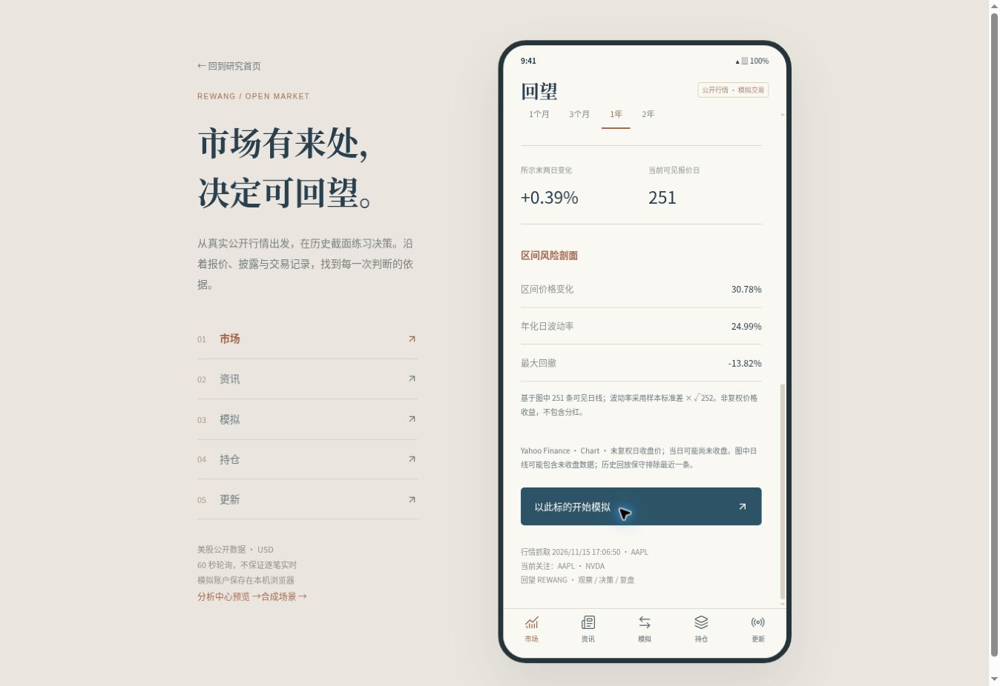
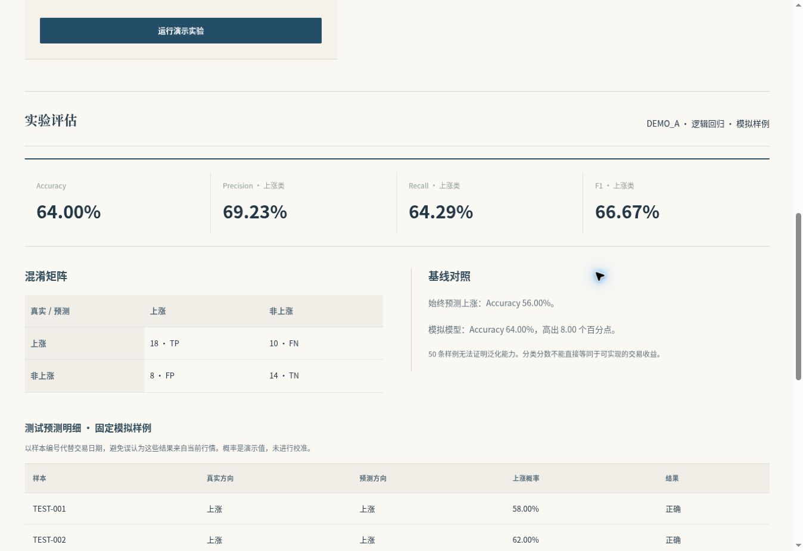

# 本轮自查记录 · 2026-11-15

## 已通过

1. Web TypeScript：`npx tsc --noEmit`。
2. Web生产构建：Sites/Vinext构建成功，市场/API/手机参考/合成模拟路由均存在。
3. Web交易计算：`node --experimental-strip-types tests/paper.mjs`。验证现金、费用、平均成本、已实现盈亏、不可变记录、超额卖出/资金不足/无理由/无效数量/回到过去拒绝，未来价格截断及风险指标。
4. Android：完整 JDK17 + SDK35，`assembleDebug` 成功，产出 APK。
5. Android：`testDebugUnitTest` 3项测试，0失败、0错误。验证费用与盈亏、本地序列化及无效交易不改变账户。
6. 发布 API：六家股票 `prices` 均 HTTP200，当前各251条日线；AAPL新闻12条。AAPL/MSFT/NVDA官网公告回退分别12/10/12条，AMZN为12条已核验SEC快照。源模式在响应和UI中明确显示。
7. 参数校验：未知symbol、非法range均HTTP400。
8. 浏览器流程：创建历史账户 → 买入10股 → 下一交易日 → 持仓估值、费用与原理由可见；刷新后本地账户恢复。
9. 浏览器视觉：特征选项改为可访问的选择块；混淆矩阵与基线分区，桌面实测间距48px，矩阵表宽608px未超出自身608px容器。两栏未相互覆盖。
10. 手机预览：固定底部导航、独立内容滚动区、同一象牙白/海军蓝/陶土色主题；切Tab回顶部。模拟配置和交易表单从市场风险概览中独立出来，降低操作滚动距离。
11. 轮询优化：更新中保留上次成功行情，明确标记更新/失败状态；最新快照交易要求成功且未过期的报价。

## 环境与未验证项

- 没有 Android 模拟器/真机运行验收：构建成功与单元测试不能证明所有设备的视觉、输入法、旋转和字体缩放均无问题。
- SEC在线请求在发布服务器返回403；公司源或真实快照回退已经生效，不宣称SEC实时同步已完成。
- 60秒轮询不等于逐笔实时行情，公开数据源没有商业服务SLA。
- 账户是本地模拟，未验证登录鉴权/跨设备同步/真实训练/真实大模型；这些能力本轮未声称完成。
- Sites本地预览的外部请求曾报内部网络错误；真实数据链路在已发布站点验证，未通过伪造数据掩盖该错误。

## APK

路径：`artifacts/rewang-debug.apk`。

SHA-256：`faa893fe4f726469356968aeb3d7958efcf552f258d4ace31616a09e7b9bc8d9`

调试签名，仅供课程测试；非应用商店正式发行包。

## 最终浏览器回归补充

- 持仓切页后 `scrollTop=0`；手机内容区 `scrollWidth=clientWidth`，新闻长标题无横向溢出。
- 手动刷新时行情数字组件仍保留，显示“正在更新，保留上次快照”；成功后恢复正常状态。
- 最新快照重建账户已清理QA交易；浏览器预览恢复最新市场观察入口。

### 真实行情与风险分析

### 模型评估分区

